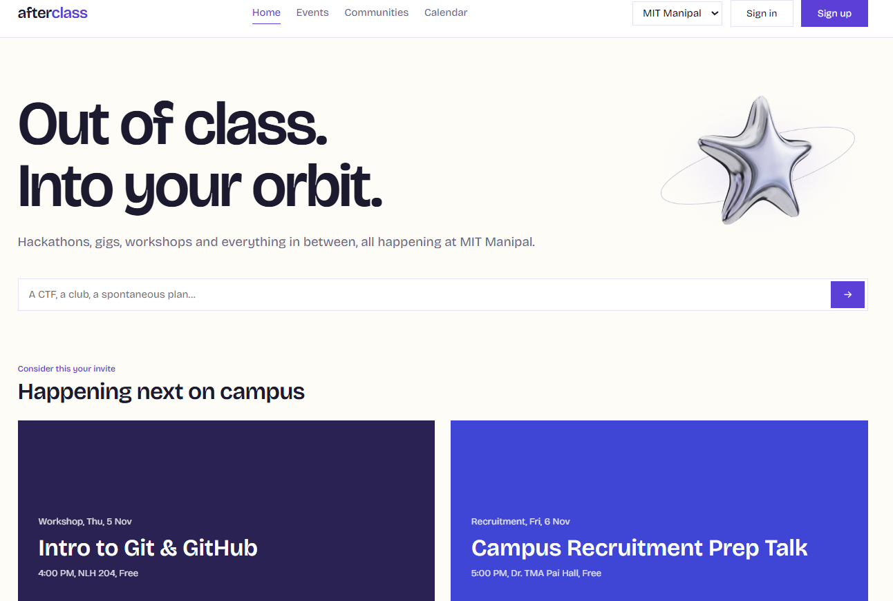

# afterclass

**A Campus Event Discovery and Management Platform**



Afterclass is a web application designed to help students discover, explore, and keep track of events happening on the MIT Manipal campus. It brings student-organised events, communities, and academic schedules together in one place.

## Features

- **Event Discovery:** Browse campus events and explore event details.
- **Search and Filtering:** Find events using keywords and categories.
- **Communities:** Explore student clubs and organisations.
- **Save Events:** Bookmark events for later.
- **Express Interest:** Keep track of events you are interested in attending.
- **Calendar:** View academic events alongside your event schedule.
- **User Accounts:** Register, sign in, and access your profile.

## Tech Stack

| Component | Technology |
|---|---|
| Frontend | HTML5, CSS3, JavaScript |
| Backend | Python, Flask |
| Database | MySQL |
| API Communication | REST API, JSON |

## Project Structure

```text
Afterclass/
├── academic.py
├── app.py
├── auth.py
├── database.py
├── events.py
├── schema.sql
├── seed.sql
├── seed_academic.sql
├── requirements.txt
└── frontend/
    ├── index.html
    ├── events.html
    ├── event.html
    ├── calendar.html
    ├── communities.html
    ├── profile.html
    ├── signin.html
    ├── signup.html
    ├── css/
    │   └── styles.css
    └── js/
        ├── api.js
        ├── auth.js
        ├── calendar.js
        ├── communities.js
        ├── event.js
        ├── explore.js
        ├── home.js
        ├── saved.js
        └── shared.js
```

## Getting Started

### Prerequisites

Make sure you have the following installed:

- Python 3
- MySQL Server
- Git

### 1. Clone the repository

```bash
git clone https://github.com/<your-username>/<repository-name>.git
cd <repository-name>
```

### 2. Set up the Python environment

Create and activate a virtual environment:

```bash
python -m venv venv
```

On Linux / WSL:

```bash
source venv/bin/activate
```

On Windows:

```bash
venv\Scripts\activate
```

Install the dependencies:

```bash
pip install -r requirements.txt
```

### 3. Set up the database

Start your MySQL server and log in:

```bash
mysql -u root -p
```

Create the database:

```sql
CREATE DATABASE afterclass;
```

Exit the MySQL prompt and import the database schema and sample data:

```bash
mysql -u root -p afterclass < schema.sql
mysql -u root -p afterclass < seed.sql
mysql -u root -p afterclass < seed_academic.sql
```

### 4. Configure environment variables

Set the database credentials used by the application.

On Linux / WSL:

```bash
export DB_USER=afterclass
export DB_PASSWORD=your_password
```

On Windows PowerShell:

```powershell
$env:DB_USER="afterclass"
$env:DB_PASSWORD="your_password"
```

Use the credentials configured for your local MySQL setup.

### 5. Run the application

Start the Flask server:

```bash
python app.py
```

Open the local application in your browser using the address printed by Flask (typically `http://127.0.0.1:5000`).
